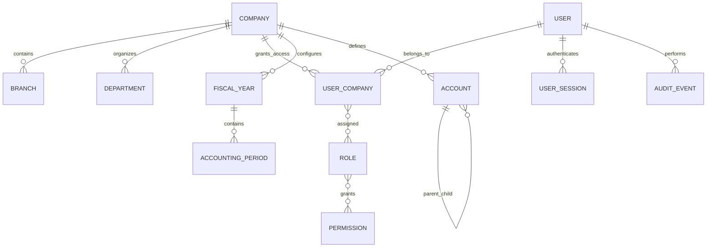

# Architecture and initial implementation plan

## System architecture

```text
Browser (planned React + TypeScript UI)
          │ HTTPS / same-origin session cookie
          ▼
API service (Node.js + TypeScript + Express + Zod)
   ├── Authentication, authorization, audit boundary
   ├── Modular domain services (introduced incrementally)
   └── Prisma data-access layer
          │ database transaction boundary
          ▼
PostgreSQL (relational source of truth)

Later, as justified: background worker/queue; private object storage for documents;
email/SMS provider; observability; backup and restore automation.
```

Keep domain logic in server-side services, validate inputs at API boundaries, and use database transactions for financial writes. The browser is never trusted to enforce accounting, tax, or permission rules. Financial posting must be append-only/immutable after posting; corrections are reversal or authorized adjustment transactions.

## Module dependency map

```text
Foundation (identity, RBAC, company/branch, periods, audit)
  ├── GL / COA / journals ──┬── AR / O2C ── CRM / client portal
  │                         ├── AP / P2P ── suppliers / SCM
  │                         ├── cash & bank
  │                         ├── fixed assets
  │                         ├── inventory / WMS
  │                         ├── payroll / HR
  │                         └── budgets / reporting
  ├── workflow & approvals (shared service across transactions)
  ├── contracts & document management (CRM, procurement, HR, projects)
  ├── projects & time/billing (CRM, O2C, HR, GL)
  └── Philippine tax & CAS framework (GL, AR, AP, payroll, configuration)
```

The GL is the financial source of truth. Subledgers must reconcile to their configured control accounts. Tax and CAS layers consume posted source records and effective-dated rules; they must not silently change historical transactions.

## Initial relational ERD (Phase 1)



Tenant-owned records include `company_id`; API queries must additionally enforce the caller's company membership. IDs are UUIDs. Amount/currency treatment, unique numbering, period controls, and append-only posting records will be expanded with the accounting-core migrations.

## Navigation structure (planned)

- Home: Executive, Finance, Operations, HR, Compliance dashboards
- Clients: leads, clients, opportunities, communications, portal requests
- Sales: quotations, engagements, service orders, invoices, collections
- Procurement: suppliers, requisitions, RFQs, purchase orders, receipts, payables
- Finance: journals, general ledger, cash/bank, fixed assets, budgets, reports
- Inventory: items, warehouses, movements, counts
- Projects: engagements, assignments, time, profitability
- People: employees, attendance, leave, payroll
- Contracts & Documents
- Tax & CAS: taxpayer setup, effective-dated rules, filing calendar, books, audit trail
- Administration: users, roles, companies, branches, periods, COA, workflows, system logs

## Phased roadmap

1. **Foundation (in progress):** architecture; database; authentication/RBAC baseline; company/branch; COA and periods schema; audit boundary; core UI system. Finish with MFA, user administration, API authorization tests, migrations, and security review.
2. **Accounting core:** immutable balanced journals, approvals, periods/closing, AR/AP, cash/bank, fixed assets, financial statements and reconciliation tests.
3. **Commercial operations:** CRM, O2C, P2P, suppliers, contracts and document controls.
4. **Operations:** SCM, WMS, inventory valuation, project/time management, budgets.
5. **HR:** employee records, attendance, leave, payroll and statutory contribution/tax configuration.
6. **Philippine compliance:** effective-dated tax configuration, forms/report workflows, books and CAS audit-readiness controls, reviewed against current BIR issuances and each taxpayer's circumstances.
7. **Finalization:** functional dashboards, reporting/export, integration/security/performance testing, backup/restore drills and production deployment.

Each phase needs acceptance criteria, automated tests, migration/rollback strategy, and explicit status before being called complete. The broad requested scope is not a one-commit implementation.

## Phase 1 boundaries and risks

This first implementation is a backend foundation, not a complete ERP UI or production-ready identity platform. It does not yet include MFA, password reset, user/role administration APIs, field-level security, workflow UI, comprehensive audit coverage, accounting transaction posting, document storage, or BIR form generation. Before live use, complete those controls, threat modeling, penetration testing, privacy review, disaster recovery exercises, and accounting/tax validation with qualified Philippine professionals. No BIR approval/accreditation or default CAS compliance is claimed.
